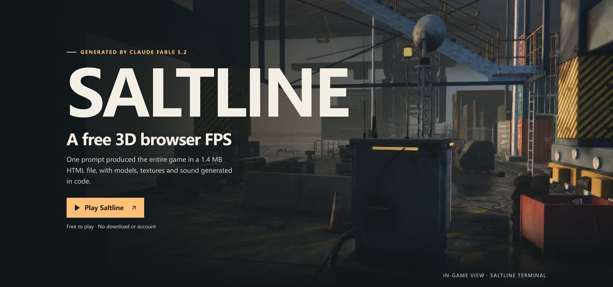
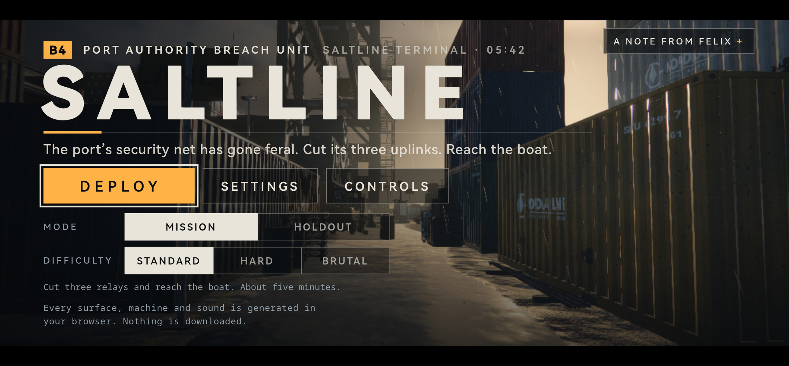
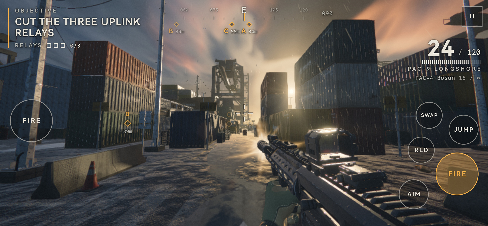

    
    <h1>Saltline</h1>
    <h3><em>for HarmonyOS</em></h3>

    <a href="./README_en.md">English</a> ·
    <strong>简体中文</strong>

## 概述

**Saltline** 是 Anthropic 工程师 Felix Rieseberg 使用 Claude Fable 5.2 生成的浏览器端单人 FPS 技术演示项目。

[Felix 的 X 原帖](https://x.com/felixrieseberg/status/2119925633564463609) |
[Claude 原始作品](https://claude.ai/artifact/BGY1SztrAYcJQHSsnHHGmp) |
[本项目维护的本地 HTML](Resources/Saltline.html)

**本项目是 Saltline 的 HarmonyOS 移植**，将 3.38 MB 的离线网页打包成单个鸿蒙应用，带来最沉浸的游玩体验。

- 游戏独占全屏
- 限制屏幕旋转
- 无浏览器控件干扰
- **纯本地运行**，不申请联网权限

|  |  |  |
|---|---|---|

## 与原始 Claude Artifact 的区别

- 原作者 Felix 的进一步修复和改进
- 触屏模式下，左侧增加一个开火键，以适配更多用户的操作习惯
