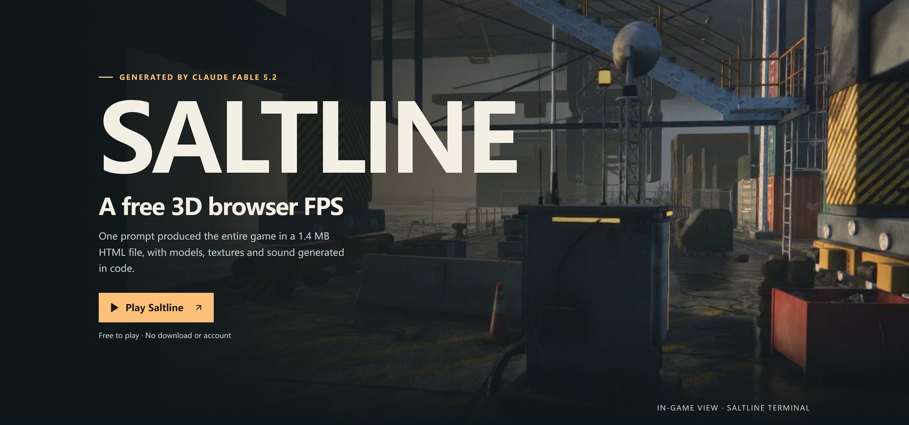
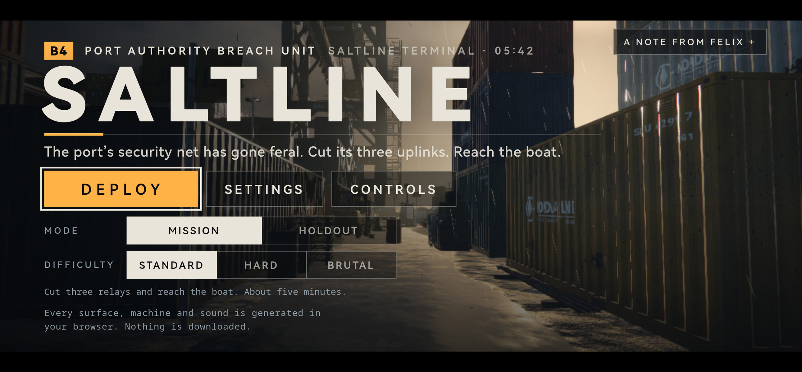
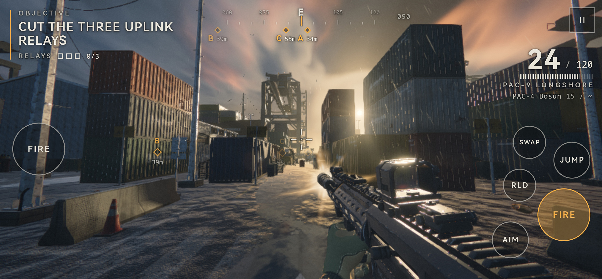

    
    <h1>Saltline</h1>
    <h3><em>for HarmonyOS</em></h3>

    <strong>English</strong> ·
    <a href="./README.md">简体中文</a>

## Overview

**Saltline** is a browser-based single-player FPS tech demo generated by Anthropic engineer Felix Rieseberg using Claude Fable 5.2.

[Felix's original post on X](https://x.com/felixrieseberg/status/2119925633564463609) |
[Original Claude artifact](https://claude.ai/artifact/BGY1SztrAYcJQHSsnHHGmp) |
[Local HTML in this project](Resources/Saltline.html)

**This project is a HarmonyOS port of Saltline**, packaging the 3.38 MB offline web page into a single HarmonyOS app for the most immersive gameplay experience.

- Game runs in exclusive full screen
- Screen rotation is locked
- No browser controls to distract
- **Runs fully offline**, with no network permission requested

|  |  |  |
|---|---|---|

## Differences from the Original Claude Artifact

- Further fixes and improvements by Felix, the original author
- In touch mode, another fire button is added on the left side to suit more players' habits
